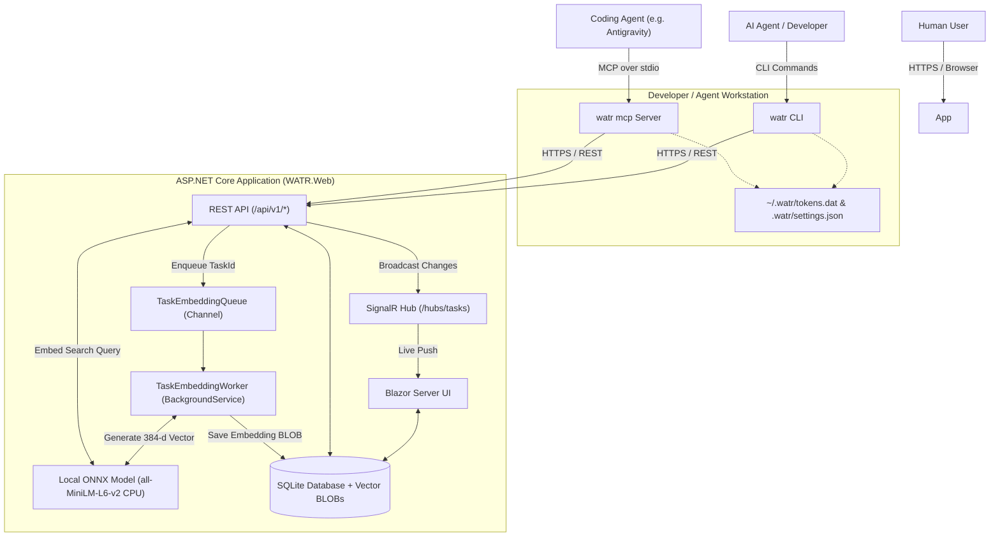

# WATR (Where's All the Records)

**WATR** is a **task management and decision support system** purpose-built for **AI coding agents** and their **human supervisors**.

Beyond tracking and coordinating active work, WATR serves as a persistent **knowledge store and external memory** for a project—capturing architectural decisions, trade-offs, root-cause investigations, and the rationale behind *why* things are the way they are. Instead of keeping all historical project context inside a model's finite context window, agents can **offload project knowledge into WATR** and retrieve it on demand via semantic vector search, making long-term progress more efficient and answering questions about system history effortless.

It combines a real-time **Blazor Server dashboard**, a **REST API**, a fast single-file **CLI (`watr`)**, a local **Model Context Protocol (MCP) server (`watr mcp`)**, and a zero-dependency **CPU semantic vector search engine** into a cohesive workflow for autonomous agents and developers.

---

## Key Features

- **Decision Support & Context Offloading:** Offload architectural decisions, design rationale ("why we built it this way"), investigation logs, and verification notes out of the model's active context window into a structured, searchable project memory.
- **Multi-Agent Task Coordination:** Plan epics, claim tasks, track statuses, and leave chronological notes so multiple agents and humans can collaborate without duplicating work.
- **Local CPU Semantic Search:** Built-in ONNX embedding pipeline (`all-MiniLM-L6-v2` via `Microsoft.ML.OnnxRuntime` and `Microsoft.Extensions.AI`) that lazily embeds task titles, bodies, and notes in the background and performs hardware-accelerated SIMD cosine similarity (`TensorPrimitives.CosineSimilarity`) directly against SQLite `BLOB` vectors—enabling instant lookup of past decisions and tasks by meaning rather than exact keywords, with no external API keys, GPUs, or native SQLite C extensions required.
- **First-Class MCP Server (`watr mcp`):** Native `stdio` Model Context Protocol server built into the CLI. Coding agents like **Antigravity**, **Claude Code**, **Cursor**, and **Windsurf** can call strongly-typed `watr_*` tools directly—inheriting local CLI authentication and workspace project settings with zero secrets in config files and zero shell-escaping issues.
- **Real-Time Human Dashboard:** Dark-mode Blazor Server UI (powered by Radzen & SignalR) that updates live as coding agents claim tasks, record decisions, post progress notes, or complete work.
- **Agent-Friendly CLI (`watr`):** Rich terminal output via `Spectre.Console` for humans, plus `--json` output, `@file.md` Markdown ingestion, and deterministic exit codes for scripts and shell-based agents.
- **Passkey + Device Code Authentication:** Passwordless **FIDO2/WebAuthn Passkeys** for browser login, paired with a GitHub-style **8-digit Device Code flow** (`watr login`) that issues auto-refreshing JWT tokens stored locally (encrypted with Windows DPAPI where supported).

---

## Architecture

The Blazor frontend, REST API (`/api/v1/*`), SignalR real-time hub (`/hubs/tasks`), and background ONNX embedding worker run inside a **single ASP.NET Core application** backed by SQLite.



### Technology Stack

| Layer | Technology |
| :--- | :--- |
| **Runtime & Framework** | .NET 10, ASP.NET Core |
| **Web Frontend** | Blazor Server (Interactive Server), Radzen.Blazor, SignalR |
| **Database & ORM** | SQLite (with inline `FLOAT32` vector `BLOB` storage), Entity Framework Core 10 |
| **Semantic Search** | `Microsoft.ML.OnnxRuntime`, `Microsoft.ML.Tokenizers` (`BertTokenizer`), `Microsoft.Extensions.AI`, `all-MiniLM-L6-v2` (384-d), `TensorPrimitives.CosineSimilarity` |
| **CLI & MCP Server** | `Spectre.Console`, `Spectre.Console.Cli`, official `ModelContextProtocol` C# SDK (`stdio` transport) |
| **Authentication** | Web: FIDO2/WebAuthn Passkeys (`fido2-net-lib`) · API/CLI/MCP: JWT Bearer + Refresh Tokens via Device Code Flow |

---

## Repository Structure

```text
WATR/
├── src/
│   ├── WATR.Web/                # ASP.NET Core host (Blazor UI, REST API, SignalR Hub, ONNX Embedding Worker)
│   ├── WATR.Cli/                # Cross-platform `watr` CLI and `watr mcp` stdio server
│   ├── WATR.Shared/             # Shared Entities, Enums, DTOs, and JSON serialization contexts
│   └── WATR.Tests/              # Unit and integration tests (Web, API, Services, CLI, MCP)
├── skills/
│   └── watr/
│       └── SKILL.md             # Portable skill file to copy into projects for coding agents (e.g. Antigravity)
├── .agents/
│   └── skills/
│       └── watr/
│           └── SKILL.md         # Active workspace skill for this repository
├── design.md                    # Full architecture and system design specification
└── WATR.slnx                    # .NET Solution file
```

---

## Getting Started

### Prerequisites

- [.NET 10 SDK](https://dotnet.microsoft.com/download/dotnet/10.0)
- A modern browser with Passkey / WebAuthn support (Chrome, Edge, Safari, Firefox)

### 1. Run the WATR Web Server

```bash
dotnet run --project src/WATR.Web
```

On first startup, `WATR.Web`:
1. Automatically creates the SQLite database (`src/WATR.Web/App_Data/WATR.db`) and applies EF Core migrations.
2. Serves the Blazor dashboard and REST API (default development URL: `https://localhost:7084`).
3. Lazily downloads and caches the `all-MiniLM-L6-v2` ONNX model (`model.onnx` and `vocab.txt`) into `App_Data/models/all-MiniLM-L6-v2/` the first time a task is embedded or searched.

Open `https://localhost:7084/login` in your browser to register an account using a **Passkey**.

### 2. Build the `watr` CLI

You can build and publish `watr` as a self-contained single-file executable using the included PowerShell script:

```powershell
./src/WATR.Cli/build.ps1
```

This publishes `watr.exe` to `./output/watr.exe`. Add the `output` directory to your `PATH` (or publish for your target OS via `dotnet publish src/WATR.Cli -c Release -r <win-x64|linux-x64|osx-x64>`).

### 3. Initialize, Authenticate & Link a Project

```bash
# 1. Point the CLI at your WATR server (saved to ~/.watr/config.json)
watr init https://localhost:7084

# 2. Authenticate via the 8-digit Device Code flow (opens /device in browser)
watr login

# 3. Create a project and link the current workspace directory (.watr/settings.json)
watr project create "WATR" --description "Core WATR development"
watr project set "WATR"

# 4. Verify connection and active project context
watr status
```

---

## Integrating with Coding Agents (Antigravity, Claude Code, Cursor)

### 1. Configure the MCP Server (`watr mcp`)

Once you have authenticated on your machine with `watr init` and `watr login`, register `watr mcp` in your coding agent's MCP configuration (for example, `~/.gemini/antigravity/mcp_config.json` in Antigravity):

```json
{
  "mcpServers": {
    "watr": {
      "command": "watr",
      "args": ["mcp"]
    }
  }
}
```

> [!TIP]
> Because `watr mcp` runs locally over `stdio`, it automatically shares `~/.watr/tokens.dat` (including automatic token refresh) and detects the active project from `.watr/settings.json` in the workspace root. No API keys or bearer tokens need to be hardcoded into `mcp_config.json`.

### 2. Add the WATR Skill to Your Project

To teach coding agents (like **Antigravity**) how to use WATR as both a task tracker and a decision support / context-offloading knowledge store—including semantic lookup of past architectural decisions, recording "why" rationale, task handle conventions, and separating **Task Body (Definition of Done & Context)** from **Task Notes (Activity & Decision Log)**—copy the [`skills/watr`](skills/watr/SKILL.md) directory into your target project's `.agents/skills/` folder (or install it globally):

```powershell
# Copy into a project workspace (recommended for team sharing via Git)
Copy-Item -Recurse -Force ./skills/watr <path-to-your-project>/.agents/skills/watr

# Or install globally for Antigravity on your machine
Copy-Item -Recurse -Force ./skills/watr ~/.gemini/config/skills/watr
```

### 3. Available MCP Tools

| Tool Name | Mode | Parameters | Description |
| :--- | :--- | :--- | :--- |
| `watr_status` | Read | *(none)* | Returns server URL, authenticated user, and active workspace project context. |
| `watr_list_projects` | Read | `page?`, `pageSize?` | Lists all projects accessible to the authenticated user. |
| `watr_create_project` | Write | `name`, `description?` | Creates a new project (with default types `Epic`, `Task`, `Bug`, `Decision`) and links it to `.watr/settings.json`. |
| `watr_set_project` | Write | `project` | Links the current workspace directory (`.watr/settings.json`) to an existing project. |
| `watr_list_tasks` | Read | `project?`, `status?`, `priority?`, `taskType?`, `tag?`, `assignedTo?`, `page?`, `pageSize?` | Lists tasks or decisions in a project with filtering by status, priority, taskType (`Decision`, `Epic`, `Task`, `Bug`), tag, and assignee (`"me"`). |
| `watr_search_tasks` | Read | `query`, `project?`, `status?`, `taskType?`, `tag?`, `top?`, `minScore?` | **Semantic Search:** Ranks tasks, architectural decisions, and notes by meaning using cosine similarity and returns context-aware snippets (`[Note]` and `[Superseded by ...]`). |
| `watr_get_task` | Read | `idOrHandle`, `project?` | Retrieves full task/decision details (Markdown body, tags, superseded-by handle, metadata, and notes) by GUID or handle. |
| `watr_create_task` | Write | `title`, `handle`, `body?`, `priority?`, `taskType?`, `status?`, `tags?`, `supersededByHandle?`, `project?` | Creates a new task, Epic, Bug, or Decision (auto-prefixes `handle` with the project task number; defaults `status` to `Completed` when `taskType == "Decision"`). |
| `watr_record_decision` | Write | `title`, `handle`, `rationale`, `tags?`, `supersedesHandle?`, `project?` | **Single-Call Decision Offloading:** Records an architectural or design decision (`TaskType = "Decision"`, `Status = "Completed"`) and optionally marks an older decision (`supersedesHandle`) as superseded. |
| `watr_update_task` | Write | `idOrHandle`, `title?`, `body?`, `status?`, `priority?`, `handle?`, `taskType?`, `tags?`, `supersededByHandle?`, `project?` | Partially updates any fields of an existing task or decision by GUID or handle in a single round-trip. |
| `watr_claim_task` | Write | `idOrHandle`, `project?` | Assigns a task to the current user and moves status to `InProgress`. |
| `watr_release_task` | Write | `idOrHandle`, `project?` | Unassigns a claimed task and reverts status to `Open`. |
| `watr_complete_task` | Write | `idOrHandle`, `verificationNote?`, `project?` | Optionally appends a final verification note and marks the task `Completed`. |
| `watr_add_note` | Write | `idOrHandle`, `content`, `project?` | Appends a Markdown progress, decision, or verification note to a task. |

---

## CLI Reference (`watr`)

When a workspace is linked via `watr project set <NAME>` (stored in `.watr/settings.json`), `-p|--project` is optional on all project-scoped commands.

| Command | Description |
| :--- | :--- |
| `watr init <SERVER_URL>` | Save the WATR server URL to `~/.watr/config.json`. |
| `watr login` | Authenticate via the interactive 8-digit device code flow. |
| `watr logout` | Clear stored credentials (`~/.watr/tokens.dat`). |
| `watr status` | Show current server, logged-in user, and linked workspace project. |
| `watr project list` | List all available projects. |
| `watr project create <NAME> [-d <DESC>]` | Create a new project. |
| `watr project set <NAME>` | Link the current directory (`.watr/settings.json`) to `<NAME>`. |
| `watr list [-p <NAME>] [-s <STATUS>] [-t|--type <TYPE>] [--tag <TAG>] [--json]` | List tasks or decisions in the project (`Open`, `InProgress`, `Completed`, `Blocked`, `Cancelled`). |
| `watr search <QUERY> [-p <NAME>] [-s <STATUS>] [--type <TYPE>] [--tag <TAG>] [-t|--top <TOP>] [--min-score <0..1>] [--json]` | Semantic vector search across tasks, decisions, and notes. |
| `watr show <TASK_GUID> [--json]` | Display full task details, tags, superseded status, Markdown description, and chronological notes. |
| `watr add <TITLE> -h <HANDLE> [-b <TEXT_OR_@FILE>] [--priority <LEVEL>] [-t|--type <TYPE>] [-s|--status <STATUS>] [--tags <CSV>] [--superseded-by <HANDLE>] [-p <NAME>]` | Create a task or decision record. `<HANDLE>` is required (e.g., `login-fix` becomes `42-login-fix`). |
| `watr update <TASK_GUID> [--title <T>] [--body <TEXT_OR_@FILE>] [--status <S>] [--priority <P>] [--handle <H>] [--type <TYPE>] [--tags <CSV>] [--superseded-by <HANDLE>] [--json]` | Update one or more fields on an existing task or decision. |
| `watr claim <TASK_GUID>` | Assign the task to yourself and mark it `InProgress`. |
| `watr note <TASK_GUID> <TEXT_OR_@FILE>` | Append a Markdown note or verification log to the task. |
| `watr done <TASK_GUID>` | Mark the task as `Completed`. |
| `watr mcp` | Start the Model Context Protocol (`stdio`) server. |

### Exit Codes

| Code | Meaning |
| :--- | :--- |
| `0` | Success |
| `1` | General error (invalid arguments, server error) |
| `2` | Authentication failure (not logged in or token expired) |
| `3` | Resource not found (project or task does not exist) |
| `4` | Conflict (e.g., task cannot be claimed) |

---

## REST API Summary (`/api/v1`)

All API endpoints under `/api/v1` use JWT Bearer authentication and return consistent JSON envelopes:

- `GET /api/v1/projects` & `POST /api/v1/projects` — List and create projects.
- `GET /api/v1/projects/{id}/tasks` — Paginated task list with `?status=`, `?priority=`, `?taskType=`, `?tag=`, and `?assignedTo=me` filters.
- `GET /api/v1/projects/{id}/tasks/search?q={query}&top=10&minScore=0.25&status=...&taskType=...&tag=...` — Multi-chunk CPU ONNX semantic search with context-aware `MatchedPreview` (`[Note]` and `[Superseded by ...]`) and automatic substring fallback for newly created records pending background indexing.
- `GET /api/v1/projects/{id}/tasks/handle/{handle}` — Resolve a task or decision by its human-readable handle (e.g., `42-login-fix`).
- `POST /api/v1/projects/{id}/tasks` — Create a task or decision (defaults `status` to `Completed` when `taskType == "Decision"`) and enqueue background vector embedding.
- `GET /api/v1/tasks/{id}`, `PUT /api/v1/tasks/{id}`, `PATCH /api/v1/tasks/{id}` — Inspect or update a task (mutations return the updated `TaskItemDto` directly).
- `POST /api/v1/tasks/{id}/claim` & `POST /api/v1/tasks/{id}/release` — Claim or release task assignment (returns updated `TaskItemDto`).
- `GET /api/v1/tasks/{id}/notes` & `POST /api/v1/tasks/{id}/notes` — List or append Markdown task notes.
- `GET /api/v1/user/me` — Get current authenticated user profile.
- `GET /health` — Unauthenticated health check endpoint verifying SQLite connectivity.

---

## Testing & Deployment

### Running Tests

Run the full xUnit test suite (covering API controllers, background semantic search & ONNX embeddings, CLI commands, and MCP tools):

```bash
dotnet test
```

### Deployment (Azure App Service)

`WATR.Web` is designed for single-instance deployment on **Azure App Service**:
- Configure `Jwt:SigningKey` (minimum 32 characters), `Fido2:ServerDomain`, and `Fido2:Origin` in App Service Environment Variables / Key Vault.
- Persist `App_Data` (or `/home/data`) to retain both the SQLite database (`WATR.db`) and the downloaded ONNX model files (`models/all-MiniLM-L6-v2/`).
- See [`design.md`](design.md) for complete architectural details, database schema, and operational guidance.
