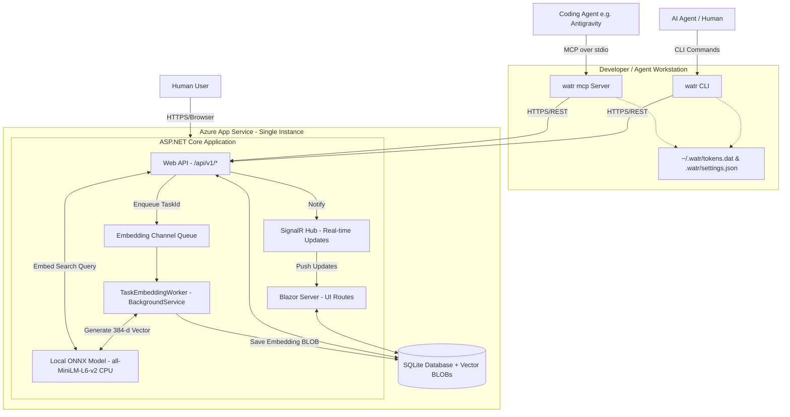

# WATR Design Document

## 1. Overview
**WATR** (Where's All the Records) is a task tracking system designed for AI coding agents and their human supervisors. It provides visibility into agent activities and facilitates coordination between multiple agents. The system consists of a centralized cloud-based web application (hosting both a Web UI and a REST API), a cross-platform CLI tool, a local **Model Context Protocol (MCP) server** (`watr mcp`) for seamless agent integration, and a built-in **CPU-based semantic search engine**.

### Core Goals
1.  **Visibility:** Provide a dashboard for humans to monitor agent progress.
2.  **Coordination:** Allow agents to claim tasks, leave notes, and update status to prevent work duplication.
3.  **Accessibility:** Accessible via Web (humans), CLI/REST API (agents & humans), and native MCP tools (coding agents like Antigravity, Claude Code, and Cursor).
4.  **Agent-Centric Interoperability:** Ensure all features are consumable by autonomous agents via MCP tool definitions, structured outputs (JSON), and stable identifiers.
5.  **Semantic Discovery:** Enable agents and humans to find relevant historical tasks, bugs, and architectural notes by meaning rather than exact keyword matches, using lazy background CPU embeddings stored directly in SQLite.

## 2. Architecture

### 2.1 High-Level Diagram
The Blazor frontend, REST API, and Background Embedding Worker are hosted within a **single ASP.NET Core application**. Blazor handles interactive UI routes while the API serves `/api/v1/*` endpoints. Coding agents can interact either via CLI commands or through the local `watr mcp` stdio server, which reuses local CLI credentials and project context.



### 2.2 Technology Stack
*   **Framework:** .NET 10 (ASP.NET Core)
*   **Hosting:** Azure App Service (Single Instance)
*   **Database:** SQLite (with inline `FLOAT32` vector `BLOB` storage)
*   **ORM:** Entity Framework Core 10
*   **Semantic Search & Embeddings:**
    *   **Runtime:** `Microsoft.ML.OnnxRuntime` (CPU execution) + `Microsoft.ML.Tokenizers` (`BertTokenizer`).
    *   **Abstraction:** `Microsoft.Extensions.AI` (`IEmbeddingGenerator<string, Embedding<float>>`).
    *   **Model:** `all-MiniLM-L6-v2` (quantized/FP32 ONNX, 384 dimensions, runs locally on CPU).
    *   **Similarity Computation:** `System.Numerics.Tensors.TensorPrimitives.CosineSimilarity` (SIMD-accelerated in-memory scan).
*   **Frontend:** Blazor Server (Interactive Server) with **Radzen.Blazor** components.
*   **CLI & MCP Server:** .NET 10 Console App using **Spectre.Console** for CLI UX and the official **ModelContextProtocol** C# SDK for `stdio` MCP server hosting (`watr mcp`).
*   **Authentication:** 
    *   **Web:** FIDO2/WebAuthn (Passkeys) via `fido2-net-lib`.
    *   **API / CLI / MCP:** JWT Bearer Tokens obtained via Device Code Flow.

## 3. Data Model

### 3.1 Schema
The database uses SQLite. IDs for Tasks are **UUID v7** (Time-sortable).

#### **Users**
| Column | Type | Notes |
| :--- | :--- | :--- |
| `Id` | `Guid` | PK |
| `Email` | `TEXT` | Unique, Normalized |
| `DisplayName` | `TEXT` | |
| `CreatedAt` | `DATETIME` | UTC |

#### **UserPassKeys**
| Column | Type | Notes |
| :--- | :--- | :--- |
| `Id` | `Guid` | PK |
| `UserId` | `Guid` | FK -> Users.Id |
| `CredentialId` | `BLOB` | FIDO2 Credential ID |
| `PublicKey` | `BLOB` | FIDO2 Public Key |
| `SignatureCounter` | `INTEGER` | Security counter |
| `AaGuid` | `Guid` | Authenticator Attestation GUID |

#### **Projects**
| Column | Type | Notes |
| :--- | :--- | :--- |
| `Id` | `Guid` | PK |
| `Name` | `TEXT` | Unique |
| `Description` | `TEXT` | |
| `CreatedByUserId` | `Guid` | FK -> Users.Id |
| `CreatedAt` | `DATETIME` | UTC |
| `UpdatedAt` | `DATETIME` | UTC |
| `TaskTypes` | `TEXT` | JSON Array (e.g., `["Epic", "Task", "Bug"]`) |

#### **ProjectMembers**
| Column | Type | Notes |
| :--- | :--- | :--- |
| `ProjectId` | `Guid` | FK, Composite PK |
| `UserId` | `Guid` | FK, Composite PK |
| `Role` | `TEXT` | e.g., "Admin", "Member" |

#### **Tasks**
| Column | Type | Notes |
| :--- | :--- | :--- |
| `Id` | `Guid` | PK, UUID v7 |
| `ProjectId` | `Guid` | FK -> Projects.Id |
| `TaskNumber` | `INTEGER` | Incremental ID per project |
| `TaskHandle` | `TEXT` | User-friendly ID (e.g., `42-login-fix`) |
| `TaskType` | `TEXT` | e.g., "Epic", "Bug" |
| `Title` | `TEXT` | |
| `Body` | `TEXT` | Markdown content |
| `Status` | `INTEGER` | 0=Open, 1=InProgress, 2=Completed, 3=Blocked, 4=Cancelled |
| `Priority` | `INTEGER` | 0=None, 1=Low, 2=Medium, 3=High, 4=Critical |
| `AssignedToUserId` | `Guid` | FK -> Users.Id (Nullable) |
| `AssignedToName` | `TEXT` | Free-text assignee (for agents/external users) |
| `CreatedByUserId` | `Guid` | FK -> Users.Id |
| `CreatedAt` | `DATETIME` | UTC |
| `UpdatedAt` | `DATETIME` | UTC |
| `ClosedAt` | `DATETIME` | UTC, Nullable. Set when Status -> Completed or Cancelled |
| `Embedding` | `BLOB` | Nullable. 384-dimensional `float32` vector (`1,536` bytes) representing composite task text (`Title` + `Body` + `Notes`) |
| `EmbeddingUpdatedAt` | `DATETIME` | UTC, Nullable. Timestamp of when `Embedding` was last computed (`< UpdatedAt` indicates stale vector) |

#### **TaskNotes**
Notes are comments left by any project participant (human or agent) on a task. They serve as a running log of implementation details, questions, and status updates.

| Column | Type | Notes |
| :--- | :--- | :--- |
| `Id` | `Guid` | PK |
| `TaskId` | `Guid` | FK -> Tasks.Id |
| `AuthorUserId` | `Guid` | FK -> Users.Id |
| `Content` | `TEXT` | Markdown content |
| `CreatedAt` | `DATETIME` | UTC |
| `UpdatedAt` | `DATETIME` | UTC, Nullable. Set if note is edited |

### 3.2 Database Configuration
*   **WAL Mode:** Must be enabled (`PRAGMA journal_mode = WAL;`) on local/dedicated disks to allow concurrent reads/writes between the Web UI thread, API threads, and background embedding worker (reverts to default journaling on Azure App Service Linux SMB mounts).
*   **Synchronous:** `PRAGMA synchronous = NORMAL;` for better performance while maintaining safety.

## 4. Authentication & Security

### 4.1 Web Authentication (Passkeys)
*   **Library:** `fido2-net-lib`
*   **Flow:**
    1.  **Registration:** User enters email -> Server generates challenge -> Browser prompts for Passkey creation -> Server verifies & stores public key.
    2.  **Login:** User enters email -> Server generates challenge -> Browser prompts for Passkey signature -> Server verifies signature -> Issues **ASP.NET Core Session Cookie**.

### 4.2 CLI & MCP Authentication (Device Code Flow)
Since the CLI and local MCP server cannot handle FIDO2 challenges directly (and to support headless agents), we use a "Device Code" style flow.

1.  **Initiation (CLI):** 
    *   CLI generates a random 8-digit code (e.g., `1234-5678`).
    *   CLI sends `POST /api/auth/device-login-init` with the code in the request body. The server stores the pending request in an in-memory cache with a 5-minute expiry.
2.  **User Interaction:**
    *   CLI displays: "Please go to `https://WATR.azurewebsites.net/device` and enter code: `1234-5678`".
    *   CLI opens the browser automatically if possible.
3.  **Polling (CLI):**
    *   CLI polls `GET /api/auth/device-login-status?code=...` every 5 seconds (timeout 5 mins).
4.  **Authorization (Web):**
    *   User logs into Web App (via Passkey).
    *   Navigates to `/device`.
    *   Enters the 8-digit code.
    *   Web App finds the pending memory-cache request and associates it with the current logged-in user.
    *   Web App marks the request as "Approved" and generates a long-lived **JWT Refresh Token** and short-lived **Access Token**.
    *   **Rate Limiting:** Failed code entry attempts are limited to 5 per session to prevent brute-force attacks on the 8-digit code.
5.  **Completion (CLI & MCP):**
    *   Next poll from CLI receives the Tokens.
    *   CLI securely stores tokens (`~/.watr/tokens.dat`, encrypted via Windows DPAPI where supported).
    *   Both CLI commands and the `watr mcp` server share `TokenStore` and `ApiClient`, automatically refreshing expired access tokens using the stored refresh token without requiring user intervention.

### 4.3 JWT Policy
*   **Issuer/Audience:** `WATR`
*   **Signing Key:** Must be stored securely in Azure App Service configuration (environment variable or Azure Key Vault reference). Never hardcoded.
*   **Claims:** `sub` (UserId), `email`, `project_roles`.
*   **Expiration:** Access Token (1 hour), Refresh Token (30 days).
*   **Revocation:** `POST /api/auth/revoke` endpoint to invalidate refresh tokens (e.g., when a device is lost or an agent is decommissioned).

### 4.4 CORS Policy
*   The API endpoints (`/api/*`) should allow cross-origin requests from any origin since they are secured by JWT Bearer tokens.
*   The Blazor UI routes should use restrictive CORS (same-origin only).

## 5. API Design (REST)

All API endpoints are prefixed with `/api/v1`. Versioning uses the URL path strategy (e.g., `/api/v2/...` for future breaking changes).

### 5.1 Pagination
All list endpoints support pagination via query parameters:
*   `?page=1&pageSize=20` (default page size: 20, max: 100).
*   Responses include a pagination envelope: `{ "items": [...], "page": 1, "pageSize": 20, "totalCount": 57 }`.

### 5.2 Error Response Format
All error responses use a consistent JSON shape:
```json
{
  "error": "not_found",
  "message": "Task with ID '...' was not found.",
  "details": null
}
```
Standard error codes: `bad_request`, `unauthorized`, `forbidden`, `not_found`, `conflict`, `internal_error`.

### 5.3 Endpoints
*   `GET /projects` - List visible projects.
*   `POST /projects` - Create a new project.
*   `GET /projects/{id}/tasks` - List tasks. Supports filtering: `?status=Open`, `?assignedTo=me`, `?priority=High`.
*   `GET /projects/{id}/tasks/search` - **Semantic Search** across tasks in a project.
    *   Query parameters: `?q={searchText}&top=10&status=Open&minScore=0.25`.
    *   Embeds `q` on the CPU via the local ONNX model, filters candidate tasks in SQLite, computes cosine similarity against stored `Embedding` blobs, and returns a ranked list of `TaskSearchResultDto` (`TaskItemSummaryDto` + `SimilarityScore` + `MatchedPreview`).
    *   Falls back to substring matching (`Title` / `Body`) for any brand-new tasks whose background embedding is still pending.
*   `POST /projects/{id}/tasks` - Create a new task (enqueues background embedding generation).
*   `GET /projects/{id}/tasks/handle/{handle}` - Get task details by human-readable handle.
*   `GET /tasks/{id}` - Get task details (includes notes inline).
*   `PUT /tasks/{id}` - Full update of task (title, body, status, priority; enqueues background re-embedding).
*   `PATCH /tasks/{id}` - Partial update. Accepts a JSON object with only the fields to change (enqueues background re-embedding if text changed).
    *   Supports: `status`, `priority`, `title`, `body`, `taskHandle`, `taskType`, `assignedToUserId`, `assignedToName`.
*   `POST /tasks/{id}/claim` - Assign task to current user (Agent).
*   `POST /tasks/{id}/release` - Unassign task.
*   `GET /tasks/{id}/notes` - List notes for a task (paginated).
*   `POST /tasks/{id}/notes` - Add a comment/note (updates `Task.UpdatedAt` and enqueues background re-embedding).
*   `GET /user/me` - Current user info.
*   `POST /api/auth/revoke` - Revoke a refresh token.

## 6. Web Frontend (Blazor)

### 6.1 Real-Time Updates
Since Blazor Server already maintains a persistent SignalR connection to the server, use it to push task changes in real-time. When any task is created, updated, claimed, or completed via the API or MCP server, all connected Blazor dashboards update instantly.

*   **Implementation:** A `TaskHub` SignalR hub broadcasts change events. The API controllers / `TaskService` call `IHubContext<TaskHub>` after successful mutations.
*   **Notifications:** Use `RadzenNotification` to display toast messages when task changes occur (e.g., "Agent X claimed task #1234").

### 6.2 Layout
*   **MainLayout:** Standard top navigation bar (Logo, Project Selector, User Profile/Logout).
*   **Theme:** Dark mode by default (coding agent aesthetic). Uses Radzen theme variables (e.g., `--rz-base-800`, `--rz-base-900`) for deep integration and proper contrast.
*   **Keyboard Shortcuts:** `n` to create new task, `Enter` to open selected task, `Esc` to close dialogs.

### 6.3 Pages
*   **Login:** Simple centered card with "Login with Passkey" button.
*   **Dashboard:**
    *   **Component:** `RadzenDataGrid<Task>`
    *   **Columns:** ID (truncated), Title, Type, Status (Badge), Priority (Badge), Assigned To (Avatar/Name), Updated.
    *   **Features:**
        *   **Semantic Search Bar:** Search box above the grid allowing users to search tasks by natural-language meaning (displaying similarity score badges when a search query is active).
        *   Filtering (Status: Open, InProgress, Done, Blocked, Cancelled).
        *   **"My Tasks" quick filter:** One-click toggle to show only tasks assigned to the current user.
        *   Sorting (by Date, Priority, or Similarity Score when searching).
        *   Row Selection opens a **Task Detail Dialog**.
        *   **Row Expansion:** Displays a read-only preview of the Task Body (rendered Markdown) and the latest notes directly within the grid.
*   **Task Detail (Dialog/Page):**
    *   Title (Editable).
    *   **Task Type Dropdown:** (e.g., Epic, Task) driven by Project configuration.
    *   Status Dropdown.
    *   Priority Dropdown.
    *   **Assignee Selection:**
        *   Uses `RadzenAutoComplete` to support **Hybrid Assignment**.
        *   Users can select existing Project Members OR type a free-text name (e.g., "Agent Smith").
        *   The backend attempts to resolve names to User IDs but falls back to `AssignedToName` for flexibility.
    *   Body: Markdown Viewer (rendered) + Editor tab.
    *   Notes Section: List of notes with timestamps + "Add Note" text area. Robust handling for markdown rendering failures and empty states.
*   **Device Login:** Simple form to enter the 8-digit CLI code.

## 7. CLI Tool (`watr`)

### 7.1 Implementation
*   **Library:** `Spectre.Console` for rich terminal UI (tables, spinners, colored output).
*   **Output Modes:**
    *   **Default:** Human-readable with Spectre.Console formatting.
    *   `--json`: Machine-parseable JSON output for agent consumption. Essential for integration into agent workflows.
    *   `--quiet` / `-q`: Suppress decorative output, print only essential data (IDs, status). Pairs with `--json` for full machine-readability.
*   **AOT / Single-File:** Published as a self-contained single-file executable for fast startup and easy distribution.
*   **Token Management:** The CLI automatically refreshes expired access tokens using the stored refresh token, with no user intervention required.

### 7.2 Project Context
*   `watr project set <name>`: Links the current workspace directory (via `.watr/settings.json`) to a WATR project.
*   `watr project list`: Lists available projects.
*   `watr project create <name>`: Creates a new project.
*   When a local project is linked in `.watr/settings.json`, the `--project` flag can be omitted from all CLI commands and MCP tool invocations.

### 7.3 Commands
*   `watr init <SERVER_URL>`: Initializes the global configuration (`~/.watr/config.json`) with a connection to the server. Required before running other commands.
*   `watr login`: Initiates device code flow.
*   `watr logout`: Clears local credentials.
*   `watr status`: Shows logged-in user, current project context, and summary counts (open/in-progress/blocked tasks).
*   `watr list [--project <name>] [--status <filter>]`: Key-value table of tasks. Supports `--json` flag.
*   `watr search <query> [--project <name>] [--status <filter>] [--top <n>] [--json]`: Performs semantic search across project tasks and notes, returning tasks ranked by similarity score.
*   `watr show <id-or-handle>`: Renders task details (renders Markdown to ANSI if possible). Supports `--json` flag.
*   `watr add "Title" --handle "short-name" --body "Inline text" --project <name>`: Creates a task.
    *   `--handle` is REQUIRED. It should be a short, lowercase identifier (e.g., `login-page`). The server will automatically prefix it with the task number (e.g., `42-login-page`).
    *   Body supports:
        *   `--body "Inline markdown text"` for literal content.
        *   `--body @file.md` to read from a file (RECOMMENDED for complex markdown to avoid shell escaping issues).
        *   `--body -` to read from stdin (for piping).
*   `watr update <id> [--status <status>] [--title "New Title"] [--body "text"] [--priority <level>]`: General-purpose update command for changing any task field. Supports file-based body updates via `@file.md`.
*   `watr claim <id>`: Assigns task to self.
*   `watr done <id>`: Marks task as completed.
*   `watr note <id> "Message"`: Appends a note.
*   `watr mcp`: Launches the local **Model Context Protocol (MCP)** server over `stdio` transport for coding agents (see Section 8).

### 7.4 Exit Codes
Standard exit codes for programmatic use by agents:
| Code | Meaning |
| :--- | :--- |
| `0` | Success |
| `1` | General error (invalid input, server error) |
| `2` | Authentication failure (expired token, not logged in) |
| `3` | Not found (task/project does not exist) |
| `4` | Conflict (e.g., task already claimed by another user) |

---

## 8. MCP Server Integration (`watr mcp`)

To dramatically expand WATR's usefulness to AI coding agents (such as **Antigravity**, Claude Code, Cursor, and Windsurf), WATR provides a built-in **Model Context Protocol (MCP)** server mode invoked via `watr mcp`.

### 8.1 Architecture & Design Rationale
We evaluated two primary hosting models for the MCP server:
1.  **Local `stdio` Server via CLI (`watr mcp`) [Selected]:** The coding agent spawns `watr mcp` as a local subprocess communicating over standard input/output (`stdio`).
    *   *Advantages:* Automatically inherits the developer's existing CLI authentication (`~/.watr/tokens.dat` from `watr login`) and workspace-specific project linkage (`.watr/settings.json` in the repository root). Requires zero OAuth/token configuration in the IDE's MCP config file, and avoids shell-escaping pitfalls when agents pass multi-line Markdown task bodies or notes.
2.  **Remote Streamable HTTP/SSE Server in `WATR.Web` (`/mcp`):** Hosted directly in the ASP.NET Core web app.
    *   *Trade-offs:* Requires configuring static JWT Bearer headers in the agent's MCP config, manually managing token expiration, and passing the `project` name on every tool call because the remote server does not know the agent's local working directory.

By building `watr mcp` directly into `WATR.Cli` using the official C# **`ModelContextProtocol`** SDK, agents get native, strongly-typed tool calls while reusing `ApiClient`, `ConfigService`, and `TokenStore`.

> **Critical `stdio` Constraint:** When running in `watr mcp` mode, `stdout` is strictly reserved for JSON-RPC 2.0 MCP messages. All logging must be routed to `stderr` (or suppressed), and `ProjectContextHelper` must **never** prompt interactively via `AnsiConsole.Ask`—if no project is found in the tool arguments, `.watr/settings.json`, or `DefaultProject`, the tool returns a clear structured MCP error instructing the agent to specify `projectName` or call `watr_set_project`.

### 8.2 Exposed MCP Tools
All tools return structured JSON responses (serialized from `WATR.Shared.DTOs`) so coding agents can inspect IDs, handles, statuses, and notes without parsing terminal tables.

| Tool Name | Parameters | Description |
| :--- | :--- | :--- |
| `watr_status` | `projectName?` | Returns current authenticated user, active workspace project context (`.watr/settings.json`), and task counts by status. |
| `watr_list_projects` | `page?`, `pageSize?` | Lists all projects visible to the authenticated user. |
| `watr_create_project` | `name`, `description?`, `taskTypes?` | Creates a new WATR project and optionally links it to the current workspace. |
| `watr_set_project` | `projectName` | Links the current working directory (`.watr/settings.json`) to the specified project. |
| `watr_list_tasks` | `projectName?`, `status?`, `priority?`, `assignedToMe?`, `page?`, `pageSize?` | Lists tasks in the project with optional filtering by status (`Open`, `InProgress`, `Completed`, `Blocked`, `Cancelled`), priority, and assignee. |
| `watr_search_tasks` | `query`, `projectName?`, `status?`, `top?` | **Semantic Search:** Searches tasks and notes by natural-language meaning using vector similarity, returning ranked matches with similarity scores. |
| `watr_get_task` | `idOrHandle`, `projectName?` | Retrieves full task details (Markdown body, metadata, and chronological notes) by UUID or task handle (e.g., `42-login-fix`). |
| `watr_create_task` | `title`, `handle`, `body?`, `taskType?`, `priority?`, `projectName?` | Creates a new task or Epic. Accepts raw multi-line Markdown directly in `body` without temporary files or shell escaping. |
| `watr_update_task` | `id`, `title?`, `body?`, `handle?`, `taskType?`, `status?`, `priority?` | Partially updates any combination of fields on an existing task. |
| `watr_claim_task` | `id` | Claims (assigns) a task to the current user/agent and optionally sets status to `InProgress`. |
| `watr_release_task` | `id` | Releases assignment of a task. |
| `watr_complete_task` | `id`, `verificationNote?` | Marks a task as `Completed` (and optionally appends a final verification note in a single atomic workflow). |
| `watr_add_note` | `id`, `content` | Appends a Markdown activity/progress note to a task. |

### 8.3 Agent Configuration Example (Antigravity / IDE)
Coding agents like Antigravity configure the MCP server in their `mcp_config.json` (with zero secrets required in the config file after running `watr login` once):

```json
{
  "mcpServers": {
    "watr": {
      "command": "watr",
      "args": ["mcp"]
    }
  }
}
```

---

## 9. Semantic Search & Background CPU Embedding Engine

WATR includes a built-in semantic search capability so that coding agents and humans can query tasks by concept or symptom (e.g., *"token expiration race condition"*, *"FIDO2 passkey login failure"*, *"UI layout dark mode contrast"*) and find relevant tasks even when exact keywords differ.

### 9.1 Review of Options & Architectural Decisions

#### 1. Embedding Model & CPU Runtime
*   **Option A: Local ONNX Runtime (`Microsoft.ML.OnnxRuntime` + `Microsoft.ML.Tokenizers`) with `all-MiniLM-L6-v2` [Selected]**
    *   Runs 100% locally on the CPU inside the `WATR.Web` process—no GPU, external API keys, or extra sidecar containers required.
    *   `all-MiniLM-L6-v2` (384 dimensions) is compact (~23 MB INT8 quantized or ~80 MB FP32) and embeds a typical task in **5–15 ms** on a standard CPU core.
    *   Exposed through the standard `Microsoft.Extensions.AI` `IEmbeddingGenerator<string, Embedding<float>>` interface, making it easy to swap or mock in unit tests.
*   **Option B: External Cloud Embedding APIs (OpenAI / Azure OpenAI / Gemini)**
    *   Requires external API keys, incurs per-token cost, and adds network latency/configuration overhead.
*   **Option C: Ollama Sidecar**
    *   Requires running a separate background daemon/container, which complicates single-instance Azure App Service deployments.

#### 2. Vector Storage & Similarity Search in SQLite
*   **Option A: Native SQLite `BLOB` + .NET SIMD `TensorPrimitives.CosineSimilarity` [Selected]**
    *   Each task's 384-float normalized embedding is stored directly on the `Tasks` table as a `1,536`-byte `BLOB` (`byte[]? Embedding`).
    *   When searching a project, EF Core first filters candidate tasks in SQLite using standard indexed columns (`WHERE ProjectId = @projectId AND Status = ... AND Embedding IS NOT NULL`), selecting only `{ Id, Embedding }`.
    *   The server then casts the `byte[]` blobs to `ReadOnlySpan<float>` via `MemoryMarshal.Cast<byte, float>` (zero-copy) and computes exact cosine similarity using hardware-accelerated SIMD instructions (`System.Numerics.Tensors.TensorPrimitives.CosineSimilarity`).
    *   *Why this wins for WATR:*
        1.  **Zero Native Extension Deployment Issues:** Avoids bundling platform-specific C extensions (`.dll`, `.so`, `.dylib`) or dealing with `sqlite3_load_extension` restrictions on Azure App Service.
        2.  **Full EF Core Compatibility:** Works seamlessly with standard EF Core migrations and relational pre-filtering (`ProjectId`, `Status`, `Priority`).
        3.  **Fast Enough with Zero Complexity:** Scanning 5,000 tasks (384 floats each = ~7.5 MB total) using SIMD `TensorPrimitives` takes **under 2 milliseconds** on CPU.
*   **Option B: `sqlite-vec` (`vec0` Virtual Table Extension)**
    *   Executes KNN search inside SQLite C code, but requires platform-specific native binaries, manual `LoadExtension` management, virtual table synchronization outside EF Core migrations, and has limitations when combining KNN queries with relational `WHERE` clauses (`ProjectId`, `Status`).

#### 3. Embedding Document Granularity
*   **Composite Task Vector (Selected):** A single embedding vector is stored per task, built from a structured composite document combining `TaskHandle`, `TaskType`, `Title`, `Body`, and all `TaskNotes`:
    ```text
    [{TaskType}] {TaskHandle}: {Title}

    {Body}

    Notes:
    - {Note1.Content}
    - {Note2.Content}
    ```
    Whenever a task is created, its title/body is updated, or a note is added, the task is re-queued for background re-embedding.

### 9.2 Lazy Background Processing Pipeline

To ensure task creation and updates remain instantaneous and CPU usage stays minimal:

1.  **Lazy Model Initialization:**
    *   The ONNX `InferenceSession` and `BertTokenizer` are wrapped in an async lazy initializer. The model is not loaded during `Program.cs` startup; it is only loaded into memory the first time the background worker processes a task or a user/agent executes a semantic search.
    *   If the ONNX model files (`model.onnx` and `vocab.txt`) are not present in `App_Data/models/all-MiniLM-L6-v2/`, `OnnxEmbeddingService` automatically downloads them from HuggingFace (`sentence-transformers/all-MiniLM-L6-v2`) on first use and caches them on disk.
2.  **Event-Driven Channel Queue (`TaskEmbeddingQueue`):**
    *   Backed by a bounded/unbounded `System.Threading.Channels.Channel<Guid>`.
    *   When `TaskService.CreateTaskAsync`, `UpdateTaskAsync`, or `AddNoteAsync` saves changes to SQLite, it performs a non-blocking `TryWrite(taskId)` to the channel and returns immediately to the caller.
3.  **Background Worker (`TaskEmbeddingWorker : BackgroundService`):**
    *   **Startup & Periodic Catch-Up Sweep:** After a short startup delay (e.g., 10 seconds) and periodically every 5 minutes, the worker queries SQLite for any tasks where `Embedding == null || EmbeddingUpdatedAt == null || EmbeddingUpdatedAt < UpdatedAt` and enqueues their IDs. This guarantees eventual consistency even if the server restarts before draining the in-memory channel.
    *   **Debouncing & Batching:** When a `taskId` is dequeued, the worker fetches the latest `TaskItem` + `Notes` from `WatrDbContext`, checks if `EmbeddingUpdatedAt >= UpdatedAt` (skipping redundant work if multiple rapid edits occurred), generates the 384-d L2-normalized vector on the CPU, writes the `byte[]` `Embedding` and `EmbeddingUpdatedAt = DateTime.UtcNow`, and saves to SQLite.
4.  **Hybrid Fallback during Search:**
    *   If a task was created milliseconds ago and its `Embedding` is still `null`, `SearchTasksAsync` includes a lightweight case-insensitive keyword fallback (`Title.Contains(query) || Body.Contains(query)`) so newly created tasks are still discoverable immediately.

---

## 10. Infrastructure & Deployment

### 10.1 Azure App Service
*   **Plan:** B1 or higher (for SQLite performance and CPU ONNX inference) or a Linux Container plan.
*   **Configuration:**
    *   `WEBSITE_RUN_FROM_PACKAGE = 1`
    *   Data Directory: `/home/data` (Linux) or `C:\home\data` (Windows) mapped to a persistent volume if using containers, or just `App_Data` for standard code deploy. Stores both `WATR.db` and cached ONNX model files (`models/all-MiniLM-L6-v2/`).
    *   JWT signing key stored in App Service Configuration or linked to Azure Key Vault.

### 10.2 Health Check
*   `GET /health` — Unauthenticated endpoint for Azure App Service health probes.
*   Uses ASP.NET Core `Microsoft.Extensions.Diagnostics.HealthChecks` middleware.
*   Checks: SQLite database connectivity.

### 10.3 Logging
*   Use ASP.NET Core built-in `ILogger` with structured logging.
*   Configure Application Insights for production telemetry (request tracing, exception logging, dependency tracking).
*   Log all API authentication events, task state transitions, and background embedding batch latencies at `Information` level for audit and diagnostic purposes.

### 10.4 Database Strategy
*   **Migrations:** EF Core Migrations applied automatically on application startup (`dbContext.Database.Migrate()`). Acceptable for MVP; for production scale, switch to migration scripts in the CI/CD pipeline.
*   **Backups:** Azure App Service persistent storage is not automatically backed up. Configure a daily scheduled backup of the SQLite database file using Azure App Service Backup or a simple Azure Function that copies the `.db` file to Azure Blob Storage.

### 10.5 Build System
*   **CI/CD:** GitHub Actions or Azure DevOps.
*   **Steps:**
    1.  Restore & Build Solution.
    2.  Run Unit Tests.
    3.  Publish Web App -> Artifact.
    4.  Publish CLI + MCP Server (`win-x64`, `linux-x64`, `osx-x64`) -> Artifacts.

## 11. Brand Identity

### Logo Description
**"The Hot watr"**
A cartoon vector-style watr (small onion) with a determined, slightly manic facial expression. The top of the watr (the green shoots) is engulfed in stylized orange and red flames. The watr is wearing a headset and typing on a keyboard that is melting slightly.

*Caption:* "Cooking up code."

## 12. Implementation Roadmap

1.  **Phase 1: Core Skeleton** (Completed)
    *   Setup Solution (Web, API, Shared, CLI).
    *   Configure EF Core + SQLite.
    *   Implement Basic User/Task Models.
2.  **Phase 2: Authentication** (Completed)
    *   Implement FIDO2 Web Login.
    *   Implement Device Code Token Exchange.
3.  **Phase 3: API & CLI** (Completed)
    *   Build Task CRUD API.
    *   Build `watr` CLI with Spectre.Console.
    *   Implement Agent-centric features (JSON output, File inputs).
4.  **Phase 4: Web UI** (Completed)
    *   Implement Radzen DataGrid with Row Expansion.
    *   Task Detail Views with Hybrid Assignee selection and Dark Mode theming.
    *   Real-time updates via SignalR.
5.  **Phase 5: Semantic Search & Background CPU Embeddings** (Planned)
    *   Add `Embedding` (`BLOB`) and `EmbeddingUpdatedAt` (`DATETIME`) to `Tasks` table.
    *   Implement local CPU ONNX embedding generator (`all-MiniLM-L6-v2` via `Microsoft.ML.OnnxRuntime` & `Microsoft.ML.Tokenizers`).
    *   Implement `TaskEmbeddingQueue` and lazy `TaskEmbeddingWorker` `BackgroundService`.
    *   Implement SIMD cosine similarity search (`TensorPrimitives.CosineSimilarity`) in `TaskService`, REST API (`/api/v1/projects/{id}/tasks/search`), Blazor Dashboard, and `watr search` CLI command.
6.  **Phase 6: MCP Server (`watr mcp`) for Coding Agents** (Planned)
    *   Integrate official C# `ModelContextProtocol` SDK into `WATR.Cli`.
    *   Implement `watr mcp` `stdio` server reusing local CLI auth tokens and `.watr/settings.json` project context.
    *   Expose full suite of task, note, project, and semantic search MCP tools and update `watr-manager` agent skill.

