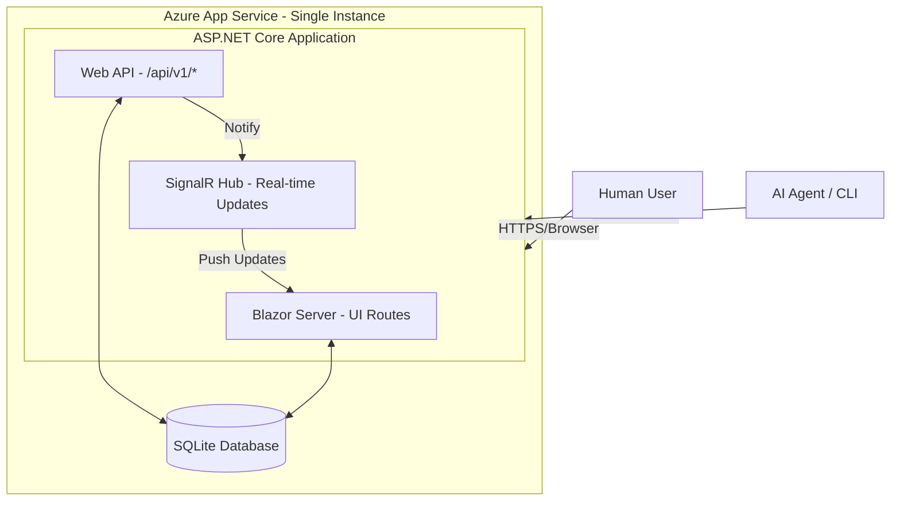

# HotShallot Design Document

## 1. Overview
**HotShallot** is a task tracking system designed for AI coding agents and their human supervisors. It provides visibility into agent activities and facilitates coordination between multiple agents. The system consists of a centralized cloud-based web application (hosting both a Web UI and a REST API) and a cross-platform CLI tool.

### Core Goals
1.  **Visibility:** Provide a dashboard for humans to monitor agent progress.
2.  **Coordination:** Allow agents to claim tasks, leave notes, and update status to prevent work duplication.
3.  **Accessibility:** accessible via Web (humans) and CLI/API (agents & humans).
4.  **Agent-Centric Interoperability:** Ensure all features are scriptable and consumable by autonomous agents via structured outputs (JSON) and stable identifiers.

## 2. Architecture

### 2.1 High-Level Diagram
The Blazor frontend and REST API are hosted within a **single ASP.NET Core application**. Blazor handles interactive UI routes while the API serves `/api/v1/*` endpoints. Both share the same process, DI container, and database context.



### 2.2 Technology Stack
*   **Framework:** .NET 10 (ASP.NET Core)
*   **Hosting:** Azure App Service (Single Instance)
*   **Database:** SQLite (WAL Mode enabled for concurrency)
*   **ORM:** Entity Framework Core 10
*   **Frontend:** Blazor Server (Interactive Server) with **Radzen.Blazor** components.
*   **CLI:** .NET 10 Console App, AOT Compiled, using **Spectre.Console**.
*   **Authentication:** 
    *   **Web:** FIDO2/WebAuthn (Passkeys) via `fido2-net-lib`.
    *   **API:** JWT Bearer Tokens.

## 3. Data Model

### 3.1 Schema
The database uses SQLite. IDs for Tasks are **UUID v7** (Time-sortable).

#### **Users**
| Column | Type | Notes |
| :--- | :--- | :--- |
| `Id` | `Guid` | PK |
| `Email` | `TEXT` | Unique, Normalized |
| `DisplayName` | `TEXT` | |
| `CreatedAt` | `DATETIME` | UTC |

#### **UserPassKeys**
| Column | Type | Notes |
| :--- | :--- | :--- |
| `Id` | `Guid` | PK |
| `UserId` | `Guid` | FK -> Users.Id |
| `CredentialId` | `BLOB` | FIDO2 Credential ID |
| `PublicKey` | `BLOB` | FIDO2 Public Key |
| `SignatureCounter` | `INTEGER` | Security counter |
| `AaGuid` | `Guid` | Authenticator Attestation GUID |

#### **Projects**
| Column | Type | Notes |
| :--- | :--- | :--- |
| `Id` | `Guid` | PK |
| `Name` | `TEXT` | Unique |
| `Description` | `TEXT` | |
| `CreatedByUserId` | `Guid` | FK -> Users.Id |
| `CreatedAt` | `DATETIME` | UTC |
| `UpdatedAt` | `DATETIME` | UTC |
| `TaskTypes` | `TEXT` | JSON Array (e.g., `["Epic", "Task", "Bug"]`) |

#### **ProjectMembers**
| Column | Type | Notes |
| :--- | :--- | :--- |
| `ProjectId` | `Guid` | FK, Composite PK |
| `UserId` | `Guid` | FK, Composite PK |
| `Role` | `TEXT` | e.g., "Admin", "Member" |

#### **Tasks**
| Column | Type | Notes |
| :--- | :--- | :--- |
| `Id` | `Guid` | PK, UUID v7 |
| `ProjectId` | `Guid` | FK -> Projects.Id |
| `TaskNumber` | `INTEGER` | Incremental ID per project |
| `TaskHandle` | `TEXT` | User-friendly ID (e.g., `PROJ-123`) |
| `TaskType` | `TEXT` | e.g., "Epic", "Bug" |
| `Title` | `TEXT` | |
| `Body` | `TEXT` | Markdown content |
| `Status` | `INTEGER` | 0=Open, 1=InProgress, 2=Completed, 3=Blocked, 4=Cancelled |
| `Priority` | `INTEGER` | 0=None, 1=Low, 2=Medium, 3=High, 4=Critical |
| `AssignedToUserId` | `Guid` | FK -> Users.Id (Nullable) |
| `AssignedToName` | `TEXT` | Free-text assignee (for agents/external users) |
| `CreatedByUserId` | `Guid` | FK -> Users.Id |
| `CreatedAt` | `DATETIME` | UTC |
| `UpdatedAt` | `DATETIME` | UTC |
| `ClosedAt` | `DATETIME` | UTC, Nullable. Set when Status -> Completed or Cancelled |

#### **TaskNotes**
Notes are comments left by any project participant (human or agent) on a task. They serve as a running log of implementation details, questions, and status updates.

| Column | Type | Notes |
| :--- | :--- | :--- |
| `Id` | `Guid` | PK |
| `TaskId` | `Guid` | FK -> Tasks.Id |
| `AuthorUserId` | `Guid` | FK -> Users.Id |
| `Content` | `TEXT` | Markdown content |
| `CreatedAt` | `DATETIME` | UTC |
| `UpdatedAt` | `DATETIME` | UTC, Nullable. Set if note is edited |

### 3.2 Database Configuration
*   **WAL Mode:** Must be enabled (`PRAGMA journal_mode = WAL;`) to allow concurrent reads/writes between the Web UI thread and API threads.
*   **Synchronous:** `PRAGMA synchronous = NORMAL;` for better performance while maintaining safety.

## 4. Authentication & Security

### 4.1 Web Authentication (Passkeys)
*   **Library:** `fido2-net-lib`
*   **Flow:**
    1.  **Registration:** User enters email -> Server generates challenge -> Browser prompts for Passkey creation -> Server verifies & stores public key.
    2.  **Login:** User enters email -> Server generates challenge -> Browser prompts for Passkey signature -> Server verifies signature -> Issues **ASP.NET Core Session Cookie**.

### 4.2 CLI Authentication (Device Code Flow)
Since the CLI cannot handle FIDO2 challenges directly (and to support headless agents), we use a "Device Code" style flow.

1.  **Initiation (CLI):** 
    *   CLI generates a random 8-digit code (e.g., `1234-5678`).
    *   CLI sends `POST /api/auth/device-login-init` with the code in the request body. The server stores the pending request in an in-memory cache with a 5-minute expiry.
2.  **User Interaction:**
    *   CLI displays: "Please go to `https://hotshallot.azurewebsites.net/device` and enter code: `1234-5678`".
    *   CLI opens the browser automatically if possible.
3.  **Polling (CLI):**
    *   CLI polls `GET /api/auth/device-login-status?code=...` every 5 seconds (timeout 5 mins).
4.  **Authorization (Web):**
    *   User logs into Web App (via Passkey).
    *   Navigates to `/device`.
    *   Enters the 8-digit code.
    *   Web App finds the pending memory-cache request and associates it with the current logged-in user.
    *   Web App marks the request as "Approved" and generates a long-lived **JWT Refresh Token** and short-lived **Access Token**.
    *   **Rate Limiting:** Failed code entry attempts are limited to 5 per session to prevent brute-force attacks on the 8-digit code.
5.  **Completion (CLI):**
    *   Next poll from CLI receives the Tokens.
    *   CLI securely stores tokens (Windows: DPAPI/CredManager).
    *   CLI automatically uses the refresh token to obtain a new access token when the current one expires, without requiring any user intervention.

### 4.3 JWT Policy
*   **Issuer/Audience:** `HotShallot`
*   **Signing Key:** Must be stored securely in Azure App Service configuration (environment variable or Azure Key Vault reference). Never hardcoded.
*   **Claims:** `sub` (UserId), `email`, `project_roles`.
*   **Expiration:** Access Token (1 hour), Refresh Token (30 days).
*   **Revocation:** `POST /api/auth/revoke` endpoint to invalidate refresh tokens (e.g., when a device is lost or an agent is decommissioned).

### 4.4 CORS Policy
*   The API endpoints (`/api/*`) should allow cross-origin requests from any origin since they are secured by JWT Bearer tokens.
*   The Blazor UI routes should use restrictive CORS (same-origin only).

## 5. API Design (REST)

All API endpoints are prefixed with `/api/v1`. Versioning uses the URL path strategy (e.g., `/api/v2/...` for future breaking changes).

### 5.1 Pagination
All list endpoints support pagination via query parameters:
*   `?page=1&pageSize=20` (default page size: 20, max: 100).
*   Responses include a pagination envelope: `{ "items": [...], "page": 1, "pageSize": 20, "totalCount": 57 }`.

### 5.2 Error Response Format
All error responses use a consistent JSON shape:
```json
{
  "error": "not_found",
  "message": "Task with ID '...' was not found.",
  "details": null
}
```
Standard error codes: `bad_request`, `unauthorized`, `forbidden`, `not_found`, `conflict`, `internal_error`.

### 5.3 Endpoints
*   `GET /projects` - List visible projects.
*   `GET /projects/{id}/tasks` - List tasks. Supports filtering: `?status=Open`, `?assignedTo=me`, `?priority=High`.
*   `POST /projects/{id}/tasks` - Create a new task.
*   `GET /tasks/{id}` - Get task details (includes notes inline).
*   `PUT /tasks/{id}` - Full update of task (title, body, status, priority).
*   `PATCH /tasks/{id}` - Partial update. Accepts a JSON object with only the fields to change.
    *   Supports: `status`, `priority`, `title`, `body`, `taskHandle`, `taskType`, `assignedToUserId`, `assignedToName`.
*   `POST /tasks/{id}/claim` - Assign task to current user (Agent).
*   `POST /tasks/{id}/release` - Unassign task.
*   `GET /tasks/{id}/notes` - List notes for a task (paginated).
*   `POST /tasks/{id}/notes` - Add a comment/note.
*   `GET /user/me` - Current user info.
*   `POST /api/auth/revoke` - Revoke a refresh token.

## 6. Web Frontend (Blazor)

### 6.1 Real-Time Updates
Since Blazor Server already maintains a persistent SignalR connection to the server, use it to push task changes in real-time. When any task is created, updated, claimed, or completed via the API, all connected Blazor dashboards update instantly.

*   **Implementation:** A `TaskHub` SignalR hub broadcasts change events. The API controllers call `IHubContext<TaskHub>` after successful mutations.
*   **Notifications:** Use `RadzenNotification` to display toast messages when task changes occur (e.g., "Agent X claimed task #1234").

### 6.2 Layout
*   **MainLayout:** Standard top navigation bar (Logo, Project Selector, User Profile/Logout).
*   **Theme:** Dark mode by default (coding agent aesthetic). Uses Radzen theme variables (e.g., `--rz-base-800`, `--rz-base-900`) for deep integration and proper contrast.
*   **Keyboard Shortcuts:** `n` to create new task, `Enter` to open selected task, `Esc` to close dialogs.

### 6.3 Pages
*   **Login:** Simple centered card with "Login with Passkey" button.
*   **Dashboard:**
    *   **Component:** `RadzenDataGrid<Task>`
    *   **Columns:** ID (truncated), Title, Type, Status (Badge), Priority (Badge), Assigned To (Avatar/Name), Updated.
    *   **Features:**
        *   Filtering (Status: Open, InProgress, Done, Blocked, Cancelled).
        *   **"My Tasks" quick filter:** One-click toggle to show only tasks assigned to the current user.
        *   Sorting (by Date, Priority).
        *   Row Selection opens a **Task Detail Dialog**.
        *   **Row Expansion:** Displays a read-only preview of the Task Body (rendered Markdown) and the latest notes directly within the grid.
*   **Task Detail (Dialog/Page):**
    *   Title (Editable).
    *   **Task Type Dropdown:** (e.g., Epic, Task) driven by Project configuration.
    *   Status Dropdown.
    *   Priority Dropdown.
    *   **Assignee Selection:**
        *   Uses `RadzenAutoComplete` to support **Hybrid Assignment**.
        *   Users can select existing Project Members OR type a free-text name (e.g., "Agent Smith").
        *   The backend attempts to resolve names to User IDs but falls back to `AssignedToName` for flexibility.
    *   Body: Markdown Viewer (rendered) + Editor tab.
    *   Notes Section: List of notes with timestamps + "Add Note" text area. Robust handling for markdown rendering failures and empty states.
*   **Device Login:** Simple form to enter the 8-digit CLI code.

## 7. CLI Tool (`shallot`)

### 7.1 Implementation
*   **Library:** `Spectre.Console` for rich terminal UI (tables, spinners, colored output).
*   **Output Modes:**
    *   **Default:** Human-readable with Spectre.Console formatting.
    *   `--json`: Machine-parseable JSON output for agent consumption. Essential for integration into agent workflows.
    *   `--quiet` / `-q`: Suppress decorative output, print only essential data (IDs, status). Pairs with `--json` for full machine-readability.
*   **AOT:** Published as Native AOT for fast startup and single-file distribution.
*   **Token Management:** The CLI automatically refreshes expired access tokens using the stored refresh token, with no user intervention required.

### 7.2 Project Context
*   `shallot project set <name>`: Sets a default project context stored in the local config file (alongside the JWT).
*   `shallot project get`: Shows the current default project.
*   When a default project is set, the `--project` flag can be omitted from all commands.

### 7.3 Commands
*   `shallot login`: Initiates device code flow.
*   `shallot logout`: Clears local credentials.
*   `shallot status`: Shows logged-in user, current project context, and summary counts (open/in-progress/blocked tasks).
*   `shallot list --project <name> --status <filter>`: Key-value table of tasks. Supports `--json` flag.
*   `shallot show <id>`: Renders task details (renders Markdown to ANSI if possible). Supports `--json` flag.
*   `shallot add "Title" --handle "short-name" --body "Inline text" --project <name>`: Creates a task.
    *   `--handle` is REQUIRED. It should be a short, lowercase identifier (e.g., `login-page`). The server will automatically prefix it with the task number (e.g., `42-login-page`).
    *   Body supports:
        *   `--body "Inline markdown text"` for literal content.
    *   `--body @file.md` to read from a file (RECOMMENDED for complex markdown to avoid shell escaping issues).
    *   `--body -` to read from stdin (for piping).
*   `shallot update <id> [--status <status>] [--title "New Title"] [--body "text"] [--priority <level>]`: General-purpose update command for changing any task field. Supports file-based body updates via `@file.md`.
*   `shallot claim <id>`: Assigns task to self.
*   `shallot done <id>`: Marks task as completed.
*   `shallot note <id> "Message"`: Appends a note.

### 7.4 Exit Codes
Standard exit codes for programmatic use by agents:
| Code | Meaning |
| :--- | :--- |
| `0` | Success |
| `1` | General error (invalid input, server error) |
| `2` | Authentication failure (expired token, not logged in) |
| `3` | Not found (task/project does not exist) |
| `4` | Conflict (e.g., task already claimed by another user) |

## 8. Infrastructure & Deployment

### 8.1 Azure App Service
*   **Plan:** B1 or higher (for SQLite performance) or a Linux Container plan.
*   **Configuration:**
    *   `WEBSITE_RUN_FROM_PACKAGE = 1`
    *   Data Directory: `/home/data` (Linux) or `C:\home\data` (Windows) mapped to a persistent volume if using containers, or just `App_Data` for standard code deploy.
    *   JWT signing key stored in App Service Configuration or linked to Azure Key Vault.

### 8.2 Health Check
*   `GET /health` — Unauthenticated endpoint for Azure App Service health probes.
*   Uses ASP.NET Core `Microsoft.Extensions.Diagnostics.HealthChecks` middleware.
*   Checks: SQLite database connectivity.

### 8.3 Logging
*   Use ASP.NET Core built-in `ILogger` with structured logging.
*   Configure Application Insights for production telemetry (request tracing, exception logging, dependency tracking).
*   Log all API authentication events and task state transitions at `Information` level for audit purposes.

### 8.4 Database Strategy
*   **Migrations:** EF Core Migrations applied automatically on application startup (`dbContext.Database.Migrate()`). Acceptable for MVP; for production scale, switch to migration scripts in the CI/CD pipeline.
*   **Backups:** Azure App Service persistent storage is not automatically backed up. Configure a daily scheduled backup of the SQLite database file using Azure App Service Backup or a simple Azure Function that copies the `.db` file to Azure Blob Storage.

### 8.5 Build System
*   **CI/CD:** GitHub Actions or Azure DevOps.
*   **Steps:**
    1.  Restore & Build Solution.
    2.  Run Unit Tests.
    3.  Publish Web App -> Artifact.
    4.  Publish CLI (win-x64, linux-x64, osx-x64) -> Artifacts.

## 9. Brand Identity

### Logo Description
**"The Hot Shallot"**
A cartoon vector-style shallot (small onion) with a determined, slightly manic facial expression. The top of the shallot (the green shoots) is engulfed in stylized orange and red flames. The shallot is wearing a headset and typing on a keyboard that is melting slightly.

*Caption:* "Cooking up code."

## 10. Implementation Roadmap

1.  **Phase 1: Core Skeleton** (Completed)
    *   Setup Solution (Web, API, Shared, CLI).
    *   Configure EF Core + SQLite.
    *   Implement Basic User/Task Models.
2.  **Phase 2: Authentication** (Completed)
    *   Implement FIDO2 Web Login.
    *   Implement Device Code Token Exchange.
3.  **Phase 3: API & CLI** (Completed)
    *   Build Task CRUD API.
    *   Build `shallot` CLI with Spectre.Console.
    *   Implement Agent-centric features (JSON output, File inputs).
4.  **Phase 4: Web UI** (Completed)
    *   Implement Radzen DataGrid with Row Expansion.
    *   Task Detail Views with Hybrid Assignee selection and Dark Mode theming.
    *   Real-time updates via SignalR.
